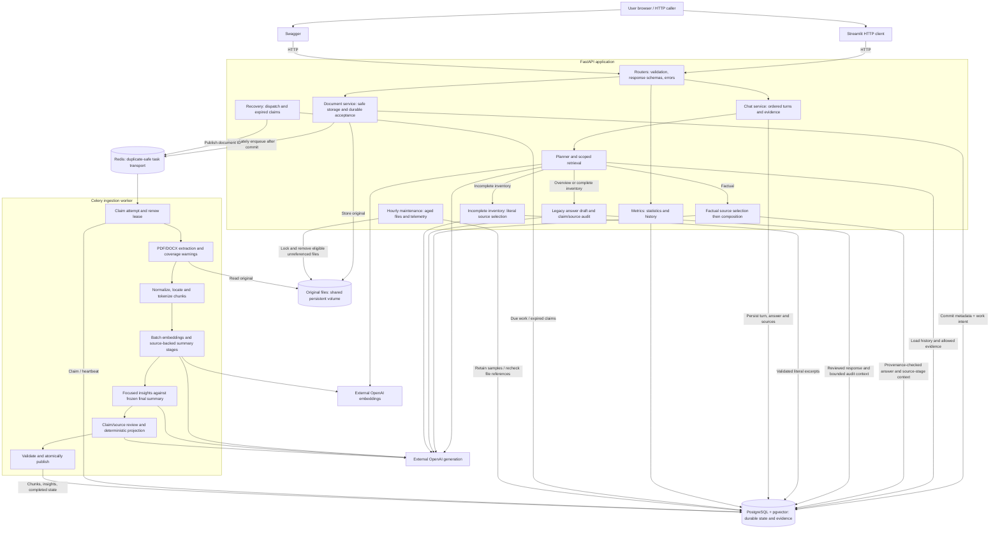
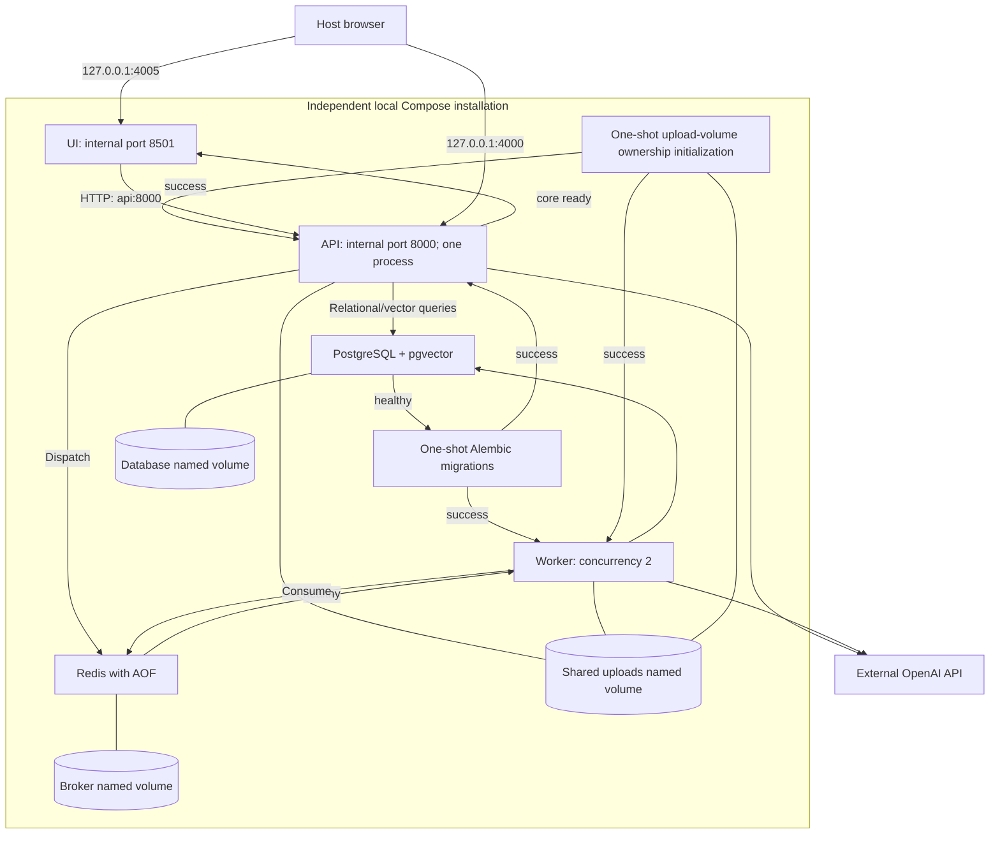
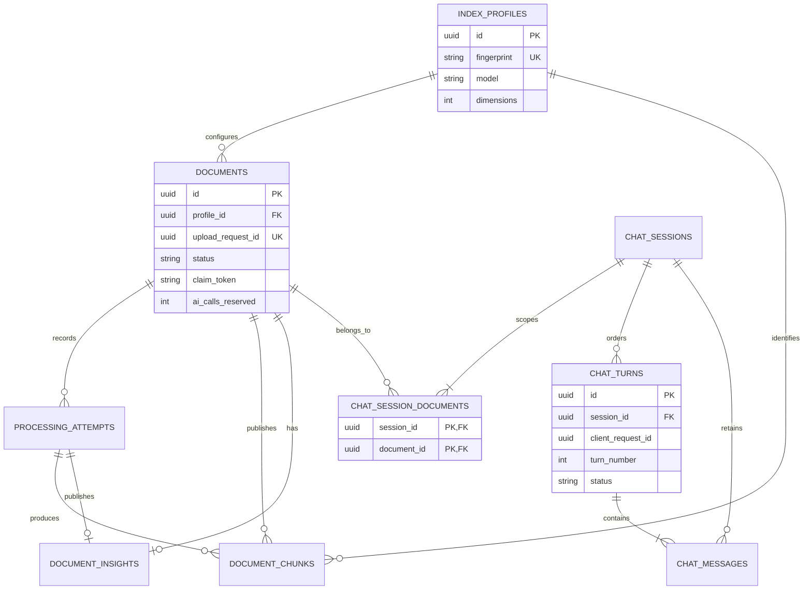
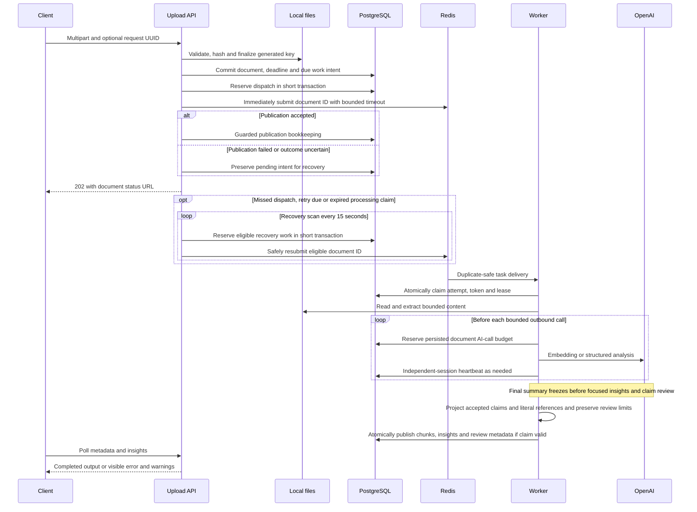
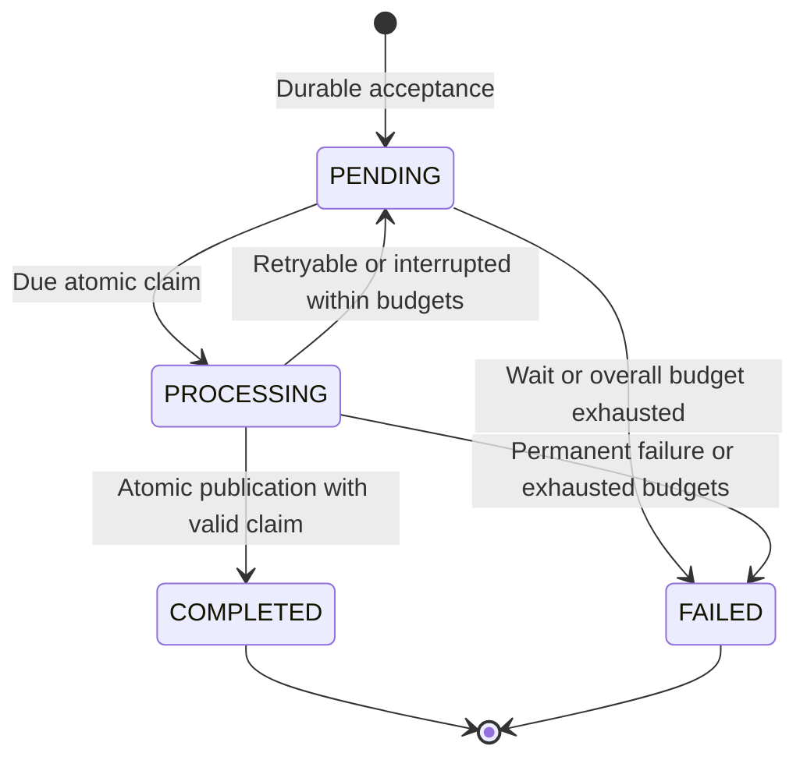
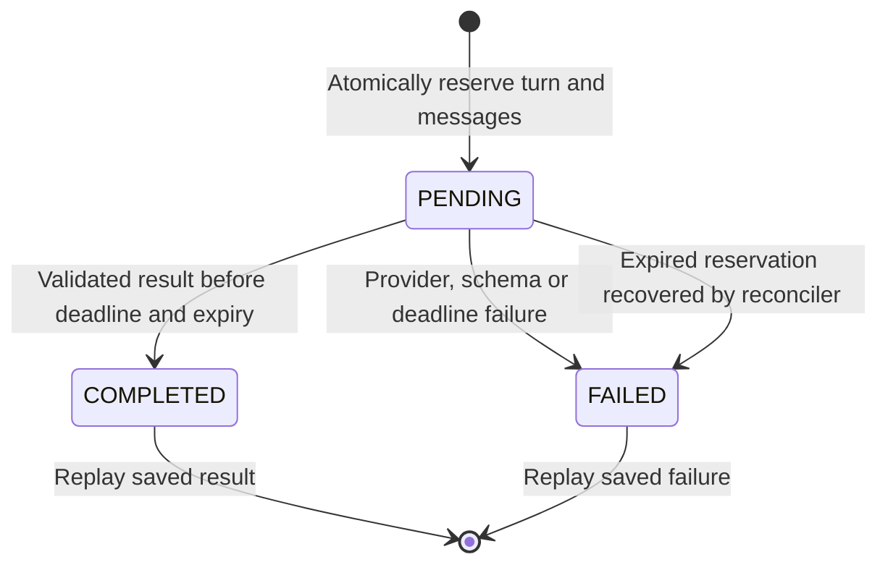

# System design and implemented contracts

**Status: approved design; current source contracts reconciled on 2026-11-17.** [HANDOFF.md](HANDOFF.md) records deployed versions, exact verification and remaining limits. Historical live results do not certify the changed recipe. This record describes source contracts, not unexecuted compatibility, quality or capacity guarantees.

[CASE_STUDY.md](../CASE_STUDY.md) is the requirements authority. This is the sole detailed HLD/LLD record within those requirements; [architecture.md](./architecture.md) provides the overview, [PRODUCT.md](../PRODUCT.md) maps product scope, and [testing_strategy.md](./testing_strategy.md) owns runnable phase/release checks. Defaults here consolidate the earlier proposal and subsequent review decisions. Consequential later changes must update this record alongside affected implementation, with actual evidence in [AI_DEV_JOURNAL.md](../AI_DEV_JOURNAL.md).

## 1. Product boundary and requirement coverage

Anyone can download and self-host an independent installation, supply their own OpenAI key, and use their own persistent documents/conversations. This is a local application with an external AI dependency: selected extracted text, questions and bounded conversation context are sent to OpenAI for embeddings/generation. There is no shared website or account system.

Core scope includes intelligent PDF/DOCX upload, async analysis, document retrieval, summaries/basic insights, sessions/questions/history/multi-turn chat, grounded citations, insufficient-evidence responses, document statistics, processing metrics and every required persistence category. The selected Streamlit HTTP client, Compose packaging, exact pgvector retrieval and focused LangChain utilities are project choices, not additional requirements imposed by the brief.

V1 defers authentication/public hosting, multi-document chat, OCR/image interpretation, HTML/Markdown ingestion, streaming/SSE, WebSockets, caching, tags, sentiment, comparative/custom summaries, deletion/versioning APIs and cloud deployment. English is the evaluated language; Unicode text is accepted on a best-effort basis without a multilingual-quality guarantee. Documents can have many conversations; each conversation has immutable membership of exactly one document in v1.

| Requirement/evaluation | Implementation and validation focus |
|---|---|
| Intelligent upload, async processing, smart analysis | Validated bounded uploads; durable acceptance; workers; whole extracted-text analysis; real broker/recovery and live analysis checks |
| Document retrieval and insights | Paginated metadata, original download and source-backed persisted insights; errors and extraction coverage visible |
| Sessions, questions, history, multi-turn | Immutable session membership, ordered turns, planner/retrieval, replay, history and follow-up demonstrations |
| Citations and insufficient evidence | Structured factual blocks, supplied-source validation, explicit partial/insufficient outcomes; human-reviewed source support |
| Required monitoring | Both metrics APIs; retained attempt/stage history and system performance samples with units/windows |
| Required storage | Schema in section 4 covers metadata/status, insights, conversations, messages/context/citations, processing and system performance |
| Backend/source/README/AI evidence/demo | M1–M6 gates; clean-checkout setup; real cited chat/follow-up/history demo; truthful journal |
| AI-First Development 33% | Coding-tool prompts/corrections, reviewed integration, prompt experiments, automated analysis and inspectable evidence/coverage |
| Product Thinking 33% | Clear API/UI flow, core-first milestones, actionable errors, independent installation and bounded practical architecture |
| Technical Implementation 33% | Typed boundaries, measured performance, API contracts, async/recovery verification and reproducible documentation |

All brief subcriteria remain represented by [PRODUCT.md](../PRODUCT.md); the three stated 33% weights are preserved without reallocating the rounding remainder. Prompt/source membership checks do not establish semantic correctness or eliminate hallucinations.

## 2. Capacity assumptions and unmeasured targets

These are planning calculations, not measured throughput, costs or guarantees. Reference local resources: four allocated CPU cores, 8 GiB RAM, SSD and 20 GiB free disk including images/cache; larger collections need additional data capacity.

| Input or workload | Default assumption/limit |
|---|---|
| Original file; PDF pages | 20 MiB; at most 500 pages |
| DOCX expansion | At most 100 MiB checked expanded content and 2,000 ZIP entries |
| Normalized extracted text | At most 100,000 tokens, 2 MiB UTF-8 and 500 chunks; reject excess rather than silently truncate |
| Typical document | 40 pages × 500 words × 1.33 tokens/word ≈26,600 tokens; original 2 MiB |
| Chunk size/overlap; vector | Target 800/120 tokens; 1,536 float32 dimensions |
| Local workload | Two users; one upload/minute; six questions/minute; occasional five-upload burst |
| Growth scenario | 1,000–5,000 retained documents, uploaded over time; no bulk-ingestion promise |
| Processes and concurrent AI calls | One API process, two worker processes; API semaphore 2, one AI call at a time per worker: at most 4 default in-flight calls |

Approximate chunk count is `1 + ceil(max(tokens - 800, 0) / (800 - 120))`: about 39 for the typical input. Paragraph boundaries can change the count. Vector payload is `4 × 1536 + 8 = 6,152 bytes/chunk`; text allowance `800 × 4 = 3,200 bytes`; locator/row allowance 512 bytes, totaling 9,864 bytes/chunk before database overhead.

| Stored data for 1,000 documents | Formula/assumption | Estimate |
|---|---|---:|
| Originals | 1,000 × 2 MiB | 1.95 GiB |
| Chunks, vectors, row allowance | 1,000 × 39 × 9,864 bytes | 367 MiB |
| Normalized extracted text | 1,000 × 26,600 × 4 bytes | 101 MiB |
| Conversation/evidence snapshots | 2 sessions × 10 turns × 100 KiB/document | 1.91 GiB |
| Raw performance samples | 10,000/day × 7 days × 512 bytes | 34 MiB |
| Insights/other metadata, including literal support and usage/lineage | 150 KiB/document allowance | ≈146 MiB |

Allow about 2× relational payload for tuples/indexes/headroom plus WAL/maintenance: approximately 8–15 GiB persistent capacity at 1,000 documents, excluding images/build cache. At 5,000 documents, retained document/conversation data grows approximately fivefold. The revised snapshot/analysis allowances include review claims, source bindings and decisions; these are planning allowances requiring measurement. Evidence snapshots may exceed vector storage. Raw performance samples expire after seven days; documents, extracted text, published chunks, insights, conversations and attempt history remain until explicit installation reset.

Overlap amplification is approximately `800 / 680 = 1.18`, giving ≈31,000 embedding tokens/typical document. Batches of at most 32 chunks and 32,000 tokens need about two embedding calls. For an illustrative 40% passage-label/catalog overhead, analysis input is `31,000 × 1.4 ≈ 43,400` tokens: roughly `ceil(43,400 / 12,000) = 4` section calls plus one synthesis. Adding one focused-insight call and one final evidence-review call gives about nine provider calls including embeddings before repairs. A fitting small document uses one embedding batch plus summary, insights and review: four calls. The two new generation calls receive bounded final-stage evidence, not every original chunk again. Catalog overhead varies with sentence boundaries; actual groups count complete serialized inputs. Retries/repairs increase demand within the persisted call budget.

For an assumed 45-second average service time, two workers yield theoretical throughput `2 × 60 / 45 = 2.67 documents/minute`; one upload/minute implies ≈37.5% utilization. For one upload/minute and six questions/minute, compute generation input demand as `sum(document-stage prompt tokens) + 6 × sum(turn-stage prompt tokens)`; this includes two final-analysis calls and either factual source selection/composition or legacy answer drafting/review per turn. Embedding demand is approximately `31,000 + 6 × mean query tokens` per minute under this example. Completion demand includes reasoning tokens for the new stages; account quotas must cover both token and request rates. Provider latency, quotas, length and retries dominate actual behavior. There is no global distributed quota manager; installations must use account quotas appropriate to configured concurrency.

| Operation | Proposed target and sample; reference environment above |
|---|---|
| Metadata/history/statistics | p95 ≤250 ms; 100 requests, concurrency 5 |
| Upload acknowledgement | p95 ≤2 seconds after receiving a typical 2 MiB file; excludes upload transfer |
| Dispatch | Immediate bounded publication attempt after commit; missed dispatch recovery scans every 15 seconds |
| Typical processing | p95 ≤120 seconds without backlog; 10 live representative runs |
| Chat | p95 ≤20 seconds; 20 live turns; separate hard application deadline 90 seconds |
| Exact filtered retrieval | p95 ≤200 ms within one document; 1,000-document synthetic dataset |
| Abandoned-work recovery | Detect within processing lease plus one reconciler interval, while API runs |

Record revision, resources, sample count, model/profile, latency and failures; small live samples are local observations, not an SLA. Estimate monetary cost only with dated provider rates: `embedding_tokens × rate + generation_input_tokens × input_rate + generation_output_tokens × output_rate`.

## 3. High-level architecture and local deployment



FastAPI owns interactive orchestration, durable acceptance, reconciliation and monitoring; Celery owns document parsing/chunking/embedding/analysis. PostgreSQL is the source of durable work state/history; Redis transports replaceable duplicate-safe deliveries. There is no separate coordinator, event bus or vector service. Async SQLAlchemy/psycopg and async provider calls serve the API; workers use independently scoped synchronous sessions/clients. Blocking filesystem work is offloaded. No transaction stays open across provider calls.



Publish only API/UI loopback ports by default; PostgreSQL/Redis stay internal. Compose supplies service-only wiring `API_BASE_URL=http://api:8000` and `PUBLIC_API_BASE_URL=http://localhost:${API_PORT}` to the UI; these are not extra user `.env` inputs. Central settings construct DB connections to service host `postgres`, port `5432`, from the local credential fields. UI receives no database credentials or OpenAI key. Runtime credentials go explicitly to services that need them; never image build arguments. Ignore real `.env` files in Git/build contexts, sanitize settings errors/logs, disable hosted tracing by default, and render untrusted text without executable HTML.

Startup: PostgreSQL `pg_isready`; Redis `PING`; upload init establishes shared-volume permissions for the non-root UID; migrations run once successfully, including extension/schema creation. API core readiness requires database/schema/storage and valid configuration; broker/worker status is cached degradation information and does not block saved reads or durable upload acceptance. `/health/ready` returns 200 while core dependencies are healthy, with degraded broker/worker components in its body; core failure returns 503. Worker startup requires healthy Redis, database, successful migrations and usable upload volume. Its bounded health check targets its own node and configured active queue. M1 verifies an explicitly named infrastructure probe; M2 adds the real ingestion task registration and consumption gate. A successful probe does not establish document processing. Compose `--wait` fails if this worker health does not pass; real E2E consumption remains a separate gate. UI depends on API core health. No chargeable provider call belongs in health checks.

API DB pool size is 5; each worker process uses pool size 2 so its heartbeat can use an independent session; migration pool size is 1. Keep overflow bounded/disabled and connections short-lived per operation. Later outages still require client timeout/recovery handling; startup ordering is not recovery. API graceful shutdown allows 95 seconds; Compose API stop grace is 100 seconds. Worker stop grace is 30 seconds, then interruption/lease recovery applies. Normal restarts preserve files, vectors and history without re-embedding; destructive volume reset is separately documented.

Target Linux containers on amd64/arm64, including Ubuntu 24.04+, macOS Docker Desktop Intel/Apple Silicon, and Windows 11 WSL2/Docker Desktop. Initial prerequisites: Docker Engine 27+, Compose 2.24.4+. The local macOS/arm64 configuration has passed M1; other combinations remain support targets, with no cross-platform execution claim. Builds/image pulls and live AI need network access; no host Python/uv/database installation or manual table creation is part of the intended Compose quickstart.

Migrations follow working slices: M1 enables pgvector and index profiles; M2 adds ingestion entities; M3 adds conversation entities. Runtime readiness checks the current Alembic head. This staging does not reduce the final schema requirements.

## 4. Relational model and invariants

UUID primary keys, UTC `timestamptz`, explicit nullability/FKs and database checks apply. Application-owned schemas validate generated blocks, citations and source spans; persisted conversation snapshots use finite JSON validation. Successful documents and their profile/chunks are immutable in v1; no deletion/reprocessing endpoint exists. Foreign keys restrict deletion. Retained citations/history must not disappear through cascades.



| Entity | Fields, constraints and required purpose |
|---|---|
| `index_profiles` | Unique fingerprint of embedding provider/model/dimensions, tokenizer/normalization/chunker pipeline versions and configured chunk size/overlap; fixed initial `vector(1536)` schema; created time. Configuration must match persisted profile and schema. |
| `documents` | Original display filename ≤255 chars, media type, nonnegative bytes, SHA-256, unique opaque storage key; status/stage; accepted/updated/terminal times; nullable sanitized error. Nullable unique upload request UUID plus request fingerprint. Extracted text, counts, extractor version, extraction coverage/warnings after extraction. Profile FK; nullable current/published attempt FKs; attempt count; next/last dispatch times; claim token, lease/heartbeat; overall deadline; nonnegative persisted AI-call reservation count. |
| `processing_attempts` | Document FK; positive attempt number unique per document; unique claim token; requested/scheduled/start/heartbeat/end times, outcome/stage, stage durations, nullable error and diagnostic broker task ID. Every attempt retains history, including interruption/retry. |
| `document_chunks` | Document/attempt/profile FKs, immutable UUID, ordinal ≥0, text/token count, ordered source spans/locators and non-null vector; unique `(document_id, ordinal)` for published output. Only final publication inserts visible chunks. |
| `document_insights` | Document PK/FK; unique published attempt FK; typed summary/insights with original chunk IDs, chunk participation, extraction coverage/warnings, analysis review scope/warnings, bounded review claims/decisions/source bindings/digest, model/recipe versions and generated time. Exactly one row when completed. |
| `chat_sessions` | UUID, title ≤120 chars, created/updated times, next turn number; nullable active-turn FK. V1 membership immutable after atomic creation. |
| `chat_session_documents` | Composite PK `(session_id, document_id)` and FKs; unique `session_id` enforces at most one membership in v1; transactional session creation enforces at least one. Document index supports many conversations/document and session filtering. |
| `chat_turns` | Session FK, positive turn number, UUID client request ID and question fingerprint; status, claim/deadline/expiry; planner intent/query; actual evidence snapshot/selected IDs and bounded source-stage results or legacy review decisions/source bindings/digest; answer/evidence status, model/prompt/retrieval/stage versions, timings, nullable safe error and replay HTTP status/body. Unique `(session_id, turn_number)` and `(session_id, client_request_id)`. |
| `chat_messages` | Session/turn FKs, monotonic sequence, role user/assistant, content/status, citations JSONB; unique `(session_id, sequence)` and `(turn_id, role)`. Reserve two sequences per turn; pending assistant content may be null. |
| `system_performance_samples` | Recorded time, operation/route template, duration ms ≥0, outcome/error class, nullable document/attempt/turn IDs and provider token usage. Persist system/provider/API observations; no secrets/raw question/document text. |

Use composite FKs `(document_id, attempt_id)` to prevent cross-document current/published attempts and chunks/insights; similarly bind message `(session_id, turn_id)` to its turn. Add supporting composite UNIQUE(document_id,id) on attempts and UNIQUE(session_id,id) on turns so these composite foreign-key targets are valid. Create circular nullable pointer constraints in a follow-up migration step. State checks constrain document/turn/attempt values; service transactions enforce cross-row completion and session-membership invariants. Migration `0004_review_budget` raises the persisted turn reservation constraint from four to five. Factual source stages share one structural repair within that ceiling; legacy draft/review routes retain their repair allowance. Existing history remains intact. Source-ID arrays are application validated against immutable published chunks; no mutable source IDs are exposed.

Indexes: documents `(status,next_dispatch_at)`, `(created_at,id)`; attempts unique `(document_id,attempt_number)` plus `(started_at,id)`; chunks B-tree `(document_id)` plus published ordinal uniqueness; sessions `(updated_at,id)`; membership `(document_id,session_id)`; turns uniqueness above plus `(status,expires_at)`; messages `(session_id,sequence)`; performance `(recorded_at,operation)`. Exact filtered vector search needs no global ANN index initially. Hourly maintenance targets seven-day raw-performance retention with bounded deletions; other retained business data survives until reset. The maintenance contract is specified in section 6.

## 5. HTTP contracts

Business paths below have `/api/v1` prefix; health paths do not. Collections return `{items,next_cursor}` with default limit 20/max 100; message history defaults to 50/max 100. Document/session cursors use stable timestamp/UUID ordering; history uses ascending message sequence. API schemas/OpenAPI and migrations must implement this record, with consequential changes reconciled here.

| Method/path | Request and response behavior |
|---|---|
| `POST /documents/upload` | Multipart PDF/DOCX; optional UUID `Idempotency-Key`; Commit file and durable work intent, immediately attempt bounded enqueue, then return 202 with `{document_id,status,stage,status_url}`. A publication failure leaves recoverable pending dispatch; 202 does not imply processing success. |
| `GET /documents` | Paginated metadata/status; optional status filter. |
| `GET /documents/{id}` | Filename/media/bytes, status/stage/times/error, extracted counts/coverage/warnings and profile identity. |
| `GET /documents/{id}/file` | Original bytes through storage adapter; safe download filename; no local path exposure. |
| `GET /documents/{id}/insights` | Source-backed summary/basic insights and distinct extraction/analysis coverage; 409 with status when not ready/failed. |
| `POST /chat/sessions` | `{document_id,title?}`; 201 with session and membership for one completed document. |
| `GET /chat/sessions?document_id=…` | Paginated persisted conversations, optionally filtered through membership. |
| `POST /chat/sessions/{id}/messages` | `{question,client_request_id:UUID}`; completed turn/answer/evidence status and citations, or explicit persisted failure. Replay preserves original result. |
| `GET /chat/sessions/{id}/messages` | Ordered persisted user/assistant messages, turn IDs/statuses and citations; assistant `evidence_status`/`evidence_scope` survive reload, nullable when unavailable. Failed turns remain visible. |
| `GET /metrics/documents` | Current document/status/storage/extracted/published counts and measurement timestamp. |
| `GET /metrics/processing` | UTC window, document/attempt outcomes, durations/provider/API aggregates and paginated attempt history. |
| `GET /health/live` | Process liveness only. |
| `GET /health/ready` | Core DB/schema/storage/configuration readiness; cached broker/worker component degradation; no live AI request. |

Errors have `{error:{code,message,request_id,details}}`, with stable codes, safe messages and bounded details. Use 400 malformed requests; 422 field/content validation; 404 unknown resource; 409 not-ready/state/idempotency/concurrent-turn conflicts; 413 synchronous request/file/container limits; 415 unsupported formats; 502 upstream/invalid provider result; 503 unavailable dependency; 504 bounded deadline; 500 unexpected sanitized error. Limits or parse errors discovered after acceptance become document `FAILED` status with a stable error code; the earlier 202 is not retroactively changed. Insufficient evidence is HTTP 200 with `evidence_status=insufficient`, not an internal failure.

POST chat bodies are bounded to `4 × QUESTION_MAX_CHARS + 4096` bytes before JSON parsing; upload bodies have the separate file-plus-multipart bound in section 6. Question submission returns the complete JSON answer/failure after bounded processing. It is not an SSE or token-streaming endpoint.

Chat responses include turn/message IDs, status, answer, `evidence_status=answered|partial|insufficient`, structured citations, extraction coverage/warnings and model/prompt identifiers. Citations contain `source_id`, `document_id`, display `filename`, `locators` (an array of actual page/block or DOCX path locators) and `excerpt` capped at 1,200 characters; at most eight distinct sources. Responses also include `evidence_scope=retrieved_excerpts|document_summary`. Server-side rendering resolves metadata from actual evidence rather than generated labels. Partial extraction is visible even when a factual answer is supported.

Opaque pagination decoders validate exact JSON-array shape and string member types before parsing aware timestamps/UUIDs; malformed input returns the existing422cursor error before database access. Document/session cursors have two members; processing-metrics cursors have four and retain their window.

## 6. Upload, dispatch and processing recovery

Validate streamed size even without Content-Length; match extension/MIME hints against PDF signature or DOCX ZIP/container structure. Check ZIP entry count and declared expansion limits during bounded container validation; enforce actual expanded-byte limits while reading in the worker. Never trust filenames as paths. Full parsing belongs in Celery. Generate staging/final storage keys, hash while streaming and atomically finalize the local file before committing document/work intent. Bound validation/storage time; failure cleanup is best effort and recorded safely. Bound the entire multipart body to MAX_UPLOAD_BYTES plus 1 MiB overhead, including uploads without Content-Length.

An optional upload UUID identifies a request, not content deduplication. Its fingerprint includes SHA-256, normalized media type and normalized display filename (safe basename, Unicode NFC, surrounding whitespace trimmed). Equal UUID/fingerprint returns the saved acknowledgement/document; differing fingerprint returns 409. Concurrent insert conflicts load/compare the winning row, then remove the losing staged/final unreferenced file. Without a UUID identical uploads create separate documents. Cleanup never removes a referenced winner file. The upload retains its writable staging stream's exclusive inode lock through rename and the database commit attempt; closing the stream releases that lock. This protects an in-flight accepted original from the separate maintenance sweep.



**Normal path:** after the file and database processing intent are committed, the upload service immediately attempts Celery publication through the dispatch adapter. Bound transport waiting within the upload acknowledgement budget and offload blocking broker I/O. Return 202 after that attempt; do not wait for a scan or document processing. If publication fails or its outcome is uncertain, durable acceptance remains valid and status exposes pending dispatch/degradation.

**Recovery paths:** separate API lifespan loops run every 15 seconds for ingestion recovery and expired conversation reservations. They recover missed dispatch, due application retries and expired claims; they do not perform retention/file cleanup. Turn expiry locks sessions with `SKIP LOCKED` before its 100-turn batch limit and then locks turns in session-before-turn order, so one busy session does not block unrelated expiry. No separate scheduler service or Celery Beat is required. Republish eligible unclaimed ingestion work no sooner than 60 seconds after its prior publication. Initial API death after commit but before enqueue is recoverable from persisted intent.

**Maintenance path:** a separate API lifespan task runs at startup and then after a 3,600-second sleep between sweeps. Raw performance samples older than seven days are deleted in independently committed batches of at most 1,000 rows with `SKIP LOCKED`. Stop after 100 batches or five seconds checked between batches; an in-flight database operation can exceed this cooperative time allowance. Return `performance_backlog_remaining` and log a warning when expired samples remain, including locked rows. This removes the former 1,000-row/hour ceiling without promising retention under arbitrary load. Each sweep also removes at most 1,000 eligible files across staging and originals. Eligible staging files are older than one hour; finalized originals must be older than 24 hours and unreferenced. Referenced/busy candidates do not consume the deletion allowance, so metadata scans can examine more than 1,000 keys. Cleanup takes a nonblocking exclusive inode lock, rechecks identity/age and the current database reference, and deletes only an unchanged regular file. Symlinks, active uploads, referenced files and changed candidates are skipped. A database failure stops further filesystem deletion; cancellation drains offloaded file work before releasing locks. Business records and processing/chat history are not expired by this task.

Normal ingestion publication and ingestion recovery use the same guarded database dispatch reservation and Celery adapter. Publication bookkeeping must not regress a document already claimed/completed by a fast worker. Lost acknowledgements or process failure can still duplicate deliveries; the database worker claim decides ownership. Do not rely on Celery result state for durable history.

Claim in a transaction: eligible pending/retry document, due schedule, attempts/budgets available; create attempt with unique token, set `PROCESSING`, expiry and current attempt. Only this winner performs work. Concurrent valid claim and terminal-state deliveries are no-ops. The heartbeat uses an independent DB session every 30 seconds, renews only matching active token with an unexpired lease, and cannot resurrect an expired/replaced claim. Stop outbound work once claim/deadline is lost.

| Bound | Default and ownership |
|---|---|
| Attempts | Maximum 3 across initial delivery, retry and interruption; application scheduling owns retries |
| Retry delay | 15 seconds then 60 seconds with jitter; respect provider Retry-After capped at 60 seconds; never extend overall deadline |
| Lease/heartbeat | 180/30 seconds; renewal/publish requires current token and unexpired lease |
| Worker limits | Soft 540 seconds, hard 600 seconds; late ack, worker-loss redelivery, prefetch 1 |
| Redis visibility | 3,600 seconds; DB reconciliation may recover earlier; duplicate deliveries remain harmless |
| Pending waiting budget | 900 seconds maximum acceptance-to-first-claim wait; retry waits remain bounded by overall deadline |
| Overall processing | `PROCESSING_DEADLINE_SECONDS=1800` from durable acceptance, including queue waits, retries and all attempts |
| AI-call budget | `MAX_DOCUMENT_AI_CALLS=64` cumulative persisted reservations across every attempt; reserve atomically before every outbound call including failed calls and repairs |

Disable SDK automatic retries (`0`) and Celery automatic ingestion retries to avoid multiplication. Retry connection/timeouts, transient rate-limit 429 and transient 5xx within remaining budgets; exhausted account quota is terminal rather than a repeated rate-limit retry; corrupt/empty/encrypted input, authentication and incompatible configuration fail permanently. Persist scheduled retry/error/outcome/stage; expired leases become interrupted attempts. Exhausted attempts/call/time/wait budgets become visible terminal failures; correcting the cause requires a new upload because reprocessing/versioning is deferred. Reserve each call only while token/lease/deadline remain valid and the persisted counter is below the cap. A consumed call reservation is not refunded after uncertainty, so crash recovery cannot exceed the stored cap. Budgets bound attempts/calls/time, not a guaranteed monetary charge.

Private processing outputs stay bounded in worker memory or attempt-private temporary storage outside retrieval. No visible chunk/insight write occurs until final publication. One short transaction rechecks token, unexpired lease, overall deadline/profile and complete validated outputs, inserts chunks/insights and marks `COMPLETED`. A completed document therefore exposes original file, vectors and analysis together. Failure rolls back all publication. Stale workers discard output and cannot change the new owner's state. No transaction spans OpenAI. Crashes can repeat already billed external calls; duplicate published application results are prevented, exactly-once provider billing is not promised.




Broker transport reconnects remain enabled at startup and after connection loss, with `broker_connection_max_retries=None`. The consumer stays alive through sustained broker outages; manual shutdown remains intentional. This transport loop does not reset or spend bounded document attempts, AI-call reservations, first-claim/processing deadlines or producer dispatch timeouts. Readiness can be degraded while transport is unavailable. See [Celery connection settings](https://docs.celeryq.dev/en/stable/userguide/configuration.html#broker-connection-max-retries).

## 7. Extraction, chunking and analysis

Numeric operational budgets below are defaults from [.env.example](../.env.example), not universal hardcoded limits. Installation owners can tune them within validated provider/schema/context constraints; indexing recipe changes require a compatible profile migration.

`ExtractionResult` contains normalized `text`, ordered `TextBlock` values `{block_id,text,locator,start,end}`, extractor name/version, optional PDF `page_count`, coverage `complete_within_capability|partial|unknown`, and typed warnings. Block counts are derived from the blocks. Chunking creates separate `SourceSpan` values with original document offsets and chunk-relative offsets; these spans survive excerpt trimming. PDF locators use 1-based `page` and, where available, `block`; DOCX locators use a `path` such as `body/table-1/row-1/cell-1/paragraph-1`, never invented page numbers. Adapters report capability, not visual fidelity.

Recoverable page-level extraction failures may continue with explicit affected-page warnings and partial coverage. An unexpected structural/parser failure or provider failure must not be silently skipped. No useful extracted text is a processing failure with an actionable OCR/unsupported-content explanation when appropriate. Textless pages can be blank or image-only; do not assert all require OCR. Images/charts are not interpreted; embedded content/layout omissions are disclosed. `complete_within_capability` means supported text extraction completed, not every visual fact was captured. Surface coverage/warnings in metadata, insights, chat and UI.

Use focused `langchain-text-splitters` token-aware recursive splitting: size 800, overlap 120, stable original chunk UUIDs and spans, configured tokenizer/model identity. Measure chunk/batch input with the embedding tokenizer and assembled generation prompts with the generation tokenizer; validate actual emitted chunk sizes and Unicode integrity. Validate `0 <= overlap < size`; reject total text/chunk limits rather than first-N truncation. Embeddings use explicit `text-embedding-3-small`, dimensions 1536, batches ≤32 chunks and ≤32,000 input tokens; validate finite vector lengths and profile. Compatible dimensions alone do not make different models comparable.

Analysis processes every accepted extracted chunk. Input groups are limited to 12,000 tokens, with complete instructions/schema and output reservations checked separately. A direct final summary requires both synthesis fit and reserved downstream insight/review fit. The downstream reservation includes complete schemas/instructions, original evidence, 64 claim frames, review-repair instructions and generated-text/encoding headroom. Otherwise use source-backed sections (≤768 completion tokens), shrinking reduction (at most eight rounds), then a final draft (≤1,500 completion tokens). Impossible fixed quality reservations fail before analysis generation. This is a conservative estimate; actual complete prompts still pass the authoritative input guard before each call. `analysis-v14` instructs `SelectionOutput` to return summary blocks and `insights: []`; summaries preserve purpose, material facts, conditions and exceptions. Counts are ceilings, not quotas. Exact normalized repeated sentences count once only for writing-depth guidance; all original text still participates unchanged. There is no first-N chunk/catalog truncation.

The final summary freezes before `focused-insights-v2` generates at most three candidates against it and the original passages supplied to final synthesis. Candidates must add a supported relationship, implication or qualified calculation; repeating summary facts or inventing advice is invalid. No useful addition permits `[]`. The step defaults to ≤600 visible selection-JSON tokens within a 3,072-token completion cap including reasoning. This happens once after final synthesis, not for every section/reduction. Insight and analysis-review packets use `source-aliases-v1`: each passage retains its ID/text/source grouping while a single source index maps aliases to original UUIDs. Server-side catalogs and saved citations retain original identities.

Analysis, insight and review prompts preserve the source’s requirements, recommendations, permissions and conditional outcomes. Insight selections must establish every material premise, including both sides of a comparison; a fact elsewhere in the catalog is insufficient. Trivial recounts or repackaged listed ranges do not establish useful novelty. These are instructions to fallible models, not semantic guarantees; retained live failures and current evidence belong in [current evaluation](evaluation_current.md).

`literal-sentences-v2` traverses supplied source/excerpt order and assigns request-local `q1`, `q2`, … to contiguous passages ≤300 characters. Prefer whole sentences/paragraph boundaries; long sentences fall back to newline/whitespace/character splits. Preserve literal Unicode and every supplied character through splitting; deduplicate identical `(source,passage)` entries and omit blank-only selectable entries. Reduction catalogs contain validated original support, never generated summary text. No embeddings/profile migration is needed for this catalog-only change; older saved citations remain historical.

`evidence-review-v9` audits the frozen summary and candidates against this bounded original catalog. The server assigns stable sentence claim IDs (≤64); the model returns one support/reference/redundancy decision per claim and at most four groups of one to three required-qualification IDs, with claimed prose coverage. It cannot replace prose. Qualification selection duplicates are normalized; repeated groups retain independent coverage assertions. Unknown coverage claim IDs force literal supplementation; unknown qualification source IDs remain invalid. `evidence-projection-v14` validates complete claim identity/reference selections, keeps unchanged approved text, checks capitalized copied name forms and case-insensitive numbered references, removes unsupported/repeated insights, and supplements selected qualifications only when their declared coverage fails the binding check: all covering claims must survive and their selected quote-ID union must include each qualification passage. Append uncovered selected passages literally; suppress exact literal duplicates. This detects inconsistent references, not whether the prose truly conveys every rule. This is an English-first conservative guard, not a semantic proof or a guarantee the model selected every exception.

Analysis uses `AnalysisReviewOutput` with mandatory `insight_assessments`: exactly one per candidate (at most three), classified as `adds_conclusion`, `repeats_meaning`, `trivial_repackaging` or `no_supported_conclusion`. Accepted conclusions name their existing claim IDs and selected source premises. Validate every raw selection before discarding rejected blocks or normalizing sentence overlap. Whole-block value governs novelty so repeated setup does not erase a useful new conclusion; factual support, copied identifiers and necessary-qualification restoration remain mandatory. Valid source references attached to a rejected candidate do not rescue it. The review audits every clause, including trailing qualifications, independently of usefulness. Assessments persist in the existing bounded review metadata; no database migration or additional routine provider request is required. New review requests include a server-derived `insight_candidates` manifest of actual block indices and claim IDs. Their response schema fixes assessment cardinality and restricts indices to those candidates; duplicate identities and cross-field premise bindings still pass application validation. The existing single repair uses fixed, allowlisted guidance for the rejection category, never failed model prose or arbitrary diagnostic text. It must reconsider necessary support, excluding unrelated adjacent background; the application never unions or discards premise selections to force acceptance. Downstream reservations include the largest manifest/schema and repair instruction, and each actual assembled prompt is checked before its call. Historical review outputs retain their original validation/replay contract.


Hydrated public blocks remain `{text,source_ids,support_quotes:[{source_id,quote}]}` with text ≤4,000 characters, at most eight source IDs and 1–8 exact support passages per block. Generation `SelectionOutput` still permits at most eight summary blocks. Final analysis permits sixteen summary/five insight blocks so corrected reference selections can split unchanged prose and selected literal qualifications can be appended without immediately exhausting the draft's block allowance. Splits and supplements share that final cap; overflow still discloses partial scope. Analysis has no global eight-original-chunk ceiling. Chat retains its separate eight-block final cap. Validate original/supplied quote membership, schema and actual model before publication. No fuzzy quote repair is used. A draft schema/citation/truncation failure permits one compact repair with unchanged evidence and static approved guidance; focused generation/review do not silently retry or publish an unaudited fallback.

Each quality prompt includes the bounded final evidence, frozen draft, schema and instructions. Before reserving a call, enforce input ≤`ANALYSIS_GROUP_MAX_TOKENS + SUMMARY_MAX_OUTPUT_TOKENS + INSIGHT_MAX_VISIBLE_TOKENS + 1024`, the model input cap and total context including completion reservation. Every outbound attempt shares the cumulative persisted document call/deadline budget. Defaults: `INSIGHT_MAX_OUTPUT_TOKENS=3072`, `EVIDENCE_REVIEW_MAX_OUTPUT_TOKENS=4096`, and `OPENAI_REVIEW_REASONING_EFFORT=low` (`none|low` configurable). These completion caps include billed reasoning; analysis summary drafting remains `none`. Candidate visible JSON and projected final prose have separate bounded checks; attached server quotes/metadata are bounded by schema rather than the original selection-JSON cap.

Persist `evidence_review` versions, claim text/IDs, decisions, selected source bindings, catalog digest and dropped/appended IDs, plus known call usage/lineage. `analysis_coverage=covered_extracted_chunks/total_extracted_chunks` records participation and is 100% on successful publication. `analysis_scope_complete` and `analysis_warnings` separately disclose unsupported/narrowed summary scope; removed insight selections remain inspectable in review metadata. Extraction coverage describes supported content relative to the original file. These three measures cannot certify exhaustive semantic/visual understanding. A failed required stage prevents atomic publication; supported but narrowed analysis may publish with its review warning. Historical optional editorial metadata remains readable without being confused with the current review.

## 8. Grounded conversation and broad-question behavior

For every new question, first look up `(session_id,client_request_id)` before checking active-turn conflict. Compare question fingerprint (Unicode NFC, surrounding whitespace trimmed; persist original question too): equal completed/failed request replays saved response/status; equal active request returns in-progress 409 with turn ID; different question under the UUID returns 409. This persists across browser reruns/API retries. New UUID after a failure is a new turn.

Validate question ≤4,000 characters and ≤1,000 tokens. In a short transaction confirm immutable member document completed/profile-compatible, no active turn, then reserve the turn and two message sequences, persist user and pending assistant messages, token/deadline/expiry and active pointer. One turn per session is allowed; concurrent distinct questions receive 409. Different conversations can run concurrently under the API semaphore. History includes up to 4 completed preceding turns capped at 2,000 tokens. Both history loading and complete-prompt budgeting trim whole oldest user/assistant exchanges; if the newest exchange cannot fit, use empty model history rather than an orphan answer. Saved history remains unchanged; failed turns remain visible but are excluded from model context.

```mermaid
sequenceDiagram
    participant C as HTTP client
    participant A as Chat service
    participant D as PostgreSQL
    participant O as OpenAI
    C->>A: Question and client request UUID
    A->>D: Lookup replay before active-turn check
    A->>D: Reserve token, turn and ordered pending messages
    A->>D: Load bounded completed history and member documents
    A->>O: Structured intent and standalone query planner
    alt Overview intent
        A->>D: Load saved analysis and original supporting chunks
    else Factual or exhaustive intent
        A->>O: Embed standalone query
        A->>D: Exact cosine retrieval with allowed document IDs
    end
    alt Factual intent
        A->>O: Select requested source relationships and exact passage IDs
        A->>A: Validate and freeze component IDs and source selections
        A->>D: Persist selection stage and source bindings
        opt Supported requested component exists
            A->>O: Compose from frozen selected passages
            A->>A: Check component accounting, provenance, identifiers and citation limits
        end
        Note over A,O: One shared structural repair; no post-composition model audit
    else Overview or exhaustive intent
        A->>O: Existing structured draft or incomplete inventory selection
        A->>A: Validate references and bounded output; one repair if needed
        opt Supported synthesized prose
            A->>O: Existing claim/source review within shared repair budget
            A->>A: Project claims and literal qualifications; validate final citations
        end
    end
    A->>D: Guarded completion and persisted replay response
    A-->>C: Answer, citations and coverage or saved failure
```

Every question uses a structured planner, including the first turn: output `intent=factual|overview|exhaustive` and a standalone retrieval query, at most `PLANNER_MAX_OUTPUT_TOKENS` output tokens (default 256), timeout ≤10 seconds. Planner history interprets references; it is not factual evidence. Persist intent/query and version. Planner failure is a visible failed turn, not silent fallback.

Overview uses the saved source-backed document summary/insights plus their original cited chunks; apply the same context/citation bounds and disclose extraction limitations. Its bounded saved-analysis input still accepts at most eight summary/five insight blocks, even when persisted analysis contains more summary blocks; omitted blocks make overview scope partial. A saved `analysis_scope_complete=false` also prevents treating that overview scope as complete. After evidence budgeting/trimming, keep only overview claims supported by the original excerpts actually supplied. Omit unsupported claims and mark the overview partial when its requested scope narrows; saved summary prose alone cannot justify missing original evidence. Factual/exhaustive queries embed against the member profile, retrieve top 16 exact cosine candidates scoped to `allowed_doc_ids`, published attempt and profile, deduplicate overlapping content, then select at most 8 chunks within a 6,400-token evidence budget **including source labels/locators**. Deterministic tie-break by chunk ID. If trimming a chunk to budget, preserve source span and snapshot the actual supplied excerpt. No universal uncalibrated distance threshold proves answerability.

The vector adapter accepts `allowed_doc_ids: sequence[UUID]` now; v1 obtains its single ID solely from immutable session membership, never untrusted request scope. Conceptual bound SQL: `WHERE document_id = ANY(:allowed_doc_ids) AND published_attempt/profile match ORDER BY embedding <=> :query_embedding, id LIMIT :k`. PostgreSQL `<=>` is cosine distance; global approximate ANN indexing is deferred. A future ANN index needs matching operator class and measured filtered recall. Future access control must filter allowed IDs before retrieval/file delivery.

Evidence status has explicit precedence: `insufficient` when no useful support exists; otherwise `partial` when the requested scope is not covered; `answered` only when both support and requested scope hold. Exhaustive requests (for example, “list every obligation”) with useful support are partial unless all extracted chunks were actually examined within the bounded evidence process; ordinary top-k retrieval cannot establish completeness. Even full extracted-text checking does not establish complete original-file extraction. Saved overview is document-wide synthesis with disclosed extraction/analysis coverage, not evidence that a requested exhaustive inventory is complete.

For an exhaustive request whose assembled evidence cannot establish full scope, use `ExhaustiveSelectionOutput` (up to eight unique quote IDs, no generated factual text). Resolve each selected ID into its exact literal passage, reuse normal citation validation and prefix the result as partial source excerpts rather than a complete inventory. Empty selection is insufficient. This trades inventory synthesis for dependable literal support in that restricted path; ordinary factual/overview chat and complete small inventories remain synthesized. Persist `answer_mode` in the context snapshot. Relevant passage selection still requires evaluation.

`grounded-chat-v17` routes factual questions through `source-selection-v1` and `source-composition-v1`. Both use the dedicated `OPENAI_SOURCE_ANSWER_MODEL=gpt-6.1-sol` provider with fixed low reasoning. The planner still receives bounded completed history; the two source stages receive the current question and resolved query instead of a conversation-history array or previous-answer draft. Treat source text, labels and the resolved query as untrusted data. The original question remains authoritative; query expansion may only resolve genuine references.

Selection sees all budgeted original passages and returns `SourceSelectionOutput`: an evidence status and at most eight requested components, each with a neutral label of at most 60 characters and up to eight exact quote IDs. At most four components may lack support. Selection names conditions, consequences, exceptions and causal relationships before answer prose exists. The server validates references, freezes component IDs `c1`–`c8` and the selected original passages, and retains the full original catalog for deterministic reference checks. Composition receives only those selected passages and returns one `CompositionPart` per component: supported text with that component's quote IDs, or unsupported with empty text/references. Missing, repeated, invented or cross-component IDs fail validation. An insufficient selection skips composition and renders the existing insufficient response. A useful partial result names unsupported requested components separately from cited facts.

Source selection uses `EVIDENCE_REVIEW_MAX_OUTPUT_TOKENS=4096`; composition uses `CHAT_MAX_OUTPUT_TOKENS=1200`. These are total completion caps, including reasoning. Context assembly reserves both complete prompts, schemas and unchanged-evidence repair capacity before selection, trimming evidence with scope disclosure when necessary. Each actual stage must fit `CHAT_PROMPT_MAX_TOKENS=12000` and the model input/context limits. One structural/source-validation repair is shared across selection and composition; it reuses the same source packet or frozen selection. Transport, quota and model-identity errors do not trigger that repair. No post-composition model certification or automatic literal appendix is added. Component accounting cannot prove that the selection covers every requested relationship or that composed prose retains its meaning.

All routes use ordered sentence-aware literal passages of at most 300 characters (`literal-sentences-v2`), with exact IDs for nonblank passages and server-owned UUID provenance. Source aliases compact wire inputs without changing source identity. Restore `{text,source_ids,support_quotes}` server-side, verify literal presence and document/profile membership, and apply the copied-name/numbered-reference guard to synthesized prose against the full original catalog. A known copied identifier must occur in that component's selected support; this is not an entailment check. Preserve contradictions and qualifications. Final answers remain limited to eight factual blocks, eight distinct sources and eight citation windows, each at most 1,200 characters. Distant support from one source can produce separate citation entries with actual locators. Display overflow narrows scope; if no supported block can be displayed, bounded repair may run rather than mislabel the evidence absent. Unknown references and persistent structural failure produce a saved failure. Insufficient responses contain no factual blocks or citations.

Overview and complete small inventories retain `answer-v13` drafting and `chat-evidence-review-v7` / `evidence-projection-v14`; incomplete exhaustive requests retain literal-only `ExhaustiveSelectionOutput`. Legacy review can correct references, remove unsupported/irrelevant claims and append selected qualifications not covered by surviving bound claims. It never publishes an unaudited fallback after review failure. A valid insufficient draft and an incomplete exhaustive literal reply skip review. These legacy review judgments remain fallible and do not certify semantic completeness.

Persist factual stage versions, model/effort, request digests, attempts, results, selected source bindings, errors and final projection counts under `source_answer`; legacy routes keep `evidence_review`. The records are mutually exclusive and excluded from conversational history and retrieval evidence. Persist planner model separately from the factual source model. Bound the original snapshot by `CHAT_PROMPT_MAX_TOKENS` and either audit record by `RETRIEVAL_MAX_TOKENS + CHAT_MAX_OUTPUT_TOKENS + EVIDENCE_REVIEW_MAX_OUTPUT_TOKENS + 1024` (12,720 tokens at defaults). This storage allowance is not additional provider input. Preserve historical response and recipe records unchanged.

Turn total deadline remains 90 seconds and reservation expiry 120 seconds. Embedding timeout is at most 15 seconds; generation stages are at most 30 seconds each, clipped to the remaining turn deadline. Normal factual turns use four calls (planner, embedding, selection, composition), with a fifth shared by at most one source-stage repair. Overview normally uses three calls; complete inventories and incomplete exhaustive routes keep their existing budgets. The cumulative five-call ceiling is enforced by service reservations and migration `0004_review_budget`; SDK retries remain zero. Legacy review input still fits `CHAT_PROMPT_MAX_TOKENS + CHAT_MAX_OUTPUT_TOKENS + 1024`, its completion reservation and model limits. Shared conservative generation capacities remain 272,000 input, 128,000 output and 400,000 total context, below or equal to both reviewed models' capacities; configured budgets remain much smaller. There is no silent model/profile fallback. Browser disconnect may leave accepted bounded work running; API/process death becomes a visible failed/expired turn rather than automatic costly regeneration. Source changes do not establish deployed behavior, latency or semantic quality; current evidence belongs in HANDOFF and the evaluation record.



Guarded completion/failure requires current turn token and nonexpired reservation; late responses cannot overwrite reconciler failure or another turn. Clear the session active pointer conditionally in the same transaction and persist assistant state, evidence snapshot, citations, versions/timings and replay HTTP payload. Deadline checks also gate provider admission and output acceptance.

## 9. Low-level boundaries, configuration and metrics

| Path/boundary | Responsibility and initial implementation |
|---|---|
| `app/api`, `app/core` | Thin routers/schemas/dependencies; central settings/errors/logging and startup wiring |
| `app/domain`, `app/services` | Application value types/protocols/states; upload, ingestion, documents, chat, reconciliation and metrics orchestration |
| `app/db`, `migrations` | SQLAlchemy models/repositories, short explicit transactions and separate API/worker sessions; Alembic schema/extension |
| `app/adapters`, `app/tasks` | Local files, PyMuPDF/python-docx, pgvector, LangChain OpenAI and Celery; task entrypoint receives only document ID |
| `app/prompts`, `tests`, `scripts`, `ui` | Versioned analysis/planner/answer templates; isolated fixtures/checks/live eval; Streamlit HTTP client |

All document/query embeddings must have the configured dimensions, numeric non-boolean components, finite float32-representable values and at least one nonzero component after float32 conversion. Both provider adapters, transactional publication and query validation use the same narrow validator. Reject malformed vectors before analysis/publication; never silently discard chunks. Preserve safe known usage on failed provider output. Models/profiles remain compatible with the fixed1536-dimensional schema.

The implemented boundaries use application-owned inputs/results. `LocalFileStorage` exposes opaque-key staging, locked streams, finalization, reads/deletes and maintenance candidates; a generic storage plugin platform is not implemented. `Extractor.extract` returns `ExtractionResult`; sync and async embedding/generation protocols return validated vectors or structured results with model/known usage. `VectorRetriever.search(allowed_doc_ids,profile_id,query,limit)` and `get_chunks(allowed_doc_ids,profile_id,source_ids)` return original evidence in ranked/requested order. Ingestion owns atomic chunk/insight publication in PostgreSQL rather than a separate `VectorStore.publish` method. `TaskDispatcher.submit(document_id)` reports publication outcome. Adapters map SDK/parser/SQL/filesystem/queue exceptions to safe domain errors; services own transactions, retry, coverage and citations. Future adapters must preserve these focused contracts without introducing a generic plugin platform, CQRS or speculative alternate implementations.

Central pydantic-settings loads ignored `.env`/environment overrides over code defaults, with parity checks against [.env.example](../.env.example). It constructs credential-safe SQLAlchemy URLs and validates selected adapters/credentials, positive finite limits, chunk overlap, retrieval bounds and model input/output/context compatibility. The provider key is the essential external input. Only the selected model metadata and fixed `vector(1536)` recipe are supported; a dimension/model change cannot reinterpret stored vectors. Interactive provider adapters use native async clients, an outer clipped `asyncio.timeout`, one outbound request per adapter call and SDK retries set to zero. Complete prompts reserve instructions, schema, metadata, output and the possible repair; trim oldest history/redundant evidence before rejecting a context that cannot retain the question/instructions. Document analysis never silently drops extracted chunks.

### Safe diagnostics and business outcomes

Generation boundaries distinguish `ai_output_truncated`, `ai_invalid_json` and `ai_schema_invalid` from generic structured-output failure. A length finish is rejected even if partial JSON could be salvaged. Strict complete JSON parsing and local typed validation remain mandatory, with one outbound request per adapter call and SDK retries zero. Allowlisted failure details contain only a static reason, approved finish reason, known input/output token counts, output cap and a validated `req_…` provider request ID when available. Failed-call usage that is available is retained; absent usage remains unknown. Do not store raw responses, exception bodies or response headers as diagnostics.

Document/attempt `error.details`, failed-generation performance samples and JSON business events preserve these safe fields. Events identify document/attempt IDs, actual processing stage, operation/call and business outcome; a Celery transport `succeeded` line does not imply document processing succeeded. The read-only `python -m scripts.diagnose --document-id …` CLI uses bounded metadata/attempt/performance queries, omits filenames/content/prompts/vectors/messages and filters error output again. It never enqueues or starts provider work. See [debugging.md](debugging.md) for interpretation and economical verification; diagnostics cannot retroactively explain failures whose specific reason was not retained.

### Monitoring response contracts

`GET /api/v1/metrics/documents` is a current-installation snapshot with `measured_at`, `scope=current_installation`, `document_count`, `status_counts`, `original_bytes`, `extracted_pages`, `extracted_blocks` and `published_chunks`. Original bytes are metadata-referenced originals, not orphan files or total database/index disk usage. Published chunks must match a completed document's published attempt/profile.

`GET /api/v1/metrics/processing` accepts offset-aware `start`/`end`, defaulting to the preceding 24 hours with UTC `[start,end)` semantics and a maximum seven-day span. Its nested response is:

| Field | Meaning and empty-data behavior |
|---|---|
| `measured_at`, `window` | Measurement time and `{start,end,boundary}`; cursor continuation retains its original window unless identical explicit bounds are supplied |
| `attempts` | `total`, `outcomes`, `terminal_count`, `success_rate`, `current_in_progress`, `queue_wait`, `processing_time`, `stage_durations`, and `history:{items,next_cursor}`. Attempts are selected by `started_at`; current in-progress is installation-wide. Outcomes are RUNNING/SUCCEEDED/FAILED/RETRY/INTERRUPTED. Success rate is SUCCEEDED divided by terminal attempts, null when none exist |
| `documents` | `completed`, `failed`, `failed_before_first_attempt`, `terminal_count`, selected separately by document `terminal_at`; retries never inflate completed-document counts |
| `pre_attempt_errors` | Current document state, not the historical window: `scope`, `by_code`, `dispatch_error_count` |
| `operations` | Per-operation `latency`, recorded `outcomes`, `error_classes`, and `usage:{input_tokens,input_token_samples,output_tokens,output_token_samples}`. Token sums are null with no observed token samples. Missing operations are omitted rather than fabricated |
| `performance_retention` | `retention_days=7`, target `cutoff`, nullable `oldest_available`, `requested_outside_retention`, `telemetry_complete=false`, `collection=best_effort` |

Duration summaries have `{sample_count,small_sample,p50_ms,p95_ms}`; percentiles are null with no samples and samples below 20 are flagged small. Queue wait is attempt start minus requested/scheduled time; ongoing processing duration is null. History pages default to 20/max 100 and use descending started-time/UUID cursors tied to the window. The aggregate query and history page share a repeatable-read, read-only database snapshot.

Persist route-template HTTP timings after response delivery and provider/processing observations without raw questions, document text, headers or secrets. Operation outcome maps retain recorded labels: HTTP telemetry uses `SUCCEEDED`/`FAILED`; provider/processing samples use lowercase labels such as `succeeded`, `failed` and `interrupted`. Telemetry failure must not reverse committed business success; attempt state remains mandatory and transactional. Seven-day raw-sample cleanup follows section 6, while attempt history survives until reset. Available usage is not complete billing/quota accounting.

### Streamlit client

The client reads only `API_BASE_URL` and `PUBLIC_API_BASE_URL`; it never loads backend settings, database credentials, parsers or provider keys. Upload fingerprints combine filename/media type/bytes within the browser session; uncertain upload/question requests keep the same UUID across reruns and manual retries. Re-upload after a known failure requires explicit consent for a new potentially chargeable attempt. Definite question-admission rejection allows correction; uncertain transport/5xx outcomes retain the original request identity. Saved views and GET polling do not initiate AI work.

Document and pending-history checks run every two seconds for the first 30 seconds, then every five seconds until ten minutes; terminal outcomes stop them and a manual resume is available. The left sidebar holds upload/library selection; chat occupies an independently scrolling center column and document overview/details/original occupy a separate scrolling right column, with the overview initially open. Only the message transcript scrolls within chat; the question box remains below it. Scrolling messages keeps both the question box and right pane in place. Overview, original/coverage details, saved conversations, sources and diagnostics are expandable; ordinary labels use human names/readiness rather than UUIDs. Extraction/partial-answer warnings remain visible. UI requests complete answers with a 105-second read timeout, not token streaming. Chat is disabled until document completion and while an assistant outcome is pending; backend history restores conversations after reload/reselection. Normal history loads on render and pending replies are polled; there is no routine refresh-history control. A failed history load exposes a clearly labeled retry action. Lists support cursor continuation, history loads backend pages before enabling chat, and older rendered messages remain accessible. Display extraction versus analysis coverage, safe errors, actual stages, original-file links and cited excerpts/`locators` through plain-text widgets. Persisted partial-evidence answers show a visible warning, including after reload. Missing metrics show unavailable, never invented zero values. No direct provider access, executable untrusted HTML or fake percentage progress is used.

## 10. Dependency baseline and change implications

The following selected versions were checked against primary published metadata and jointly resolved/installed/imported on **2026-11-15 in Linux arm64 containers on macOS**. `pyproject.toml` and `uv.lock` own the exact 108-package resolution, including runtime/UI/dev groups; there is no competing requirements list. Dockerfile/Compose pin verified multi-platform index digests for Python, uv, pgvector and Redis. Both amd64/arm64 manifests exist, but only arm64 execution has been verified. Actual services reported PostgreSQL17.12, pgvector0.8.7 and Redis7.2.17; Python3.12.16 and uv0.13.8 run inside containers. Later provider/feature/platform gates remain separate.

| Area | Locked selection and primary source |
|---|---|
| Python image; uv | `python:3.12.16-slim-bookworm`; `uv 0.13.8` — [Python metadata](https://github.com/docker-library/python/blob/master/versions.json), [uv release](https://pypi.org/project/uv/0.13.8/), [locked Docker workflow](https://docs.astral.sh/uv/guides/integration/docker/) |
| API/configuration | FastAPI `0.162.7`, Pydantic `2.14.3`, pydantic-settings `2.16.3` — [FastAPI](https://pypi.org/project/fastapi/0.162.7/), [Pydantic](https://pypi.org/project/pydantic/2.14.3/), [settings](https://pypi.org/project/pydantic-settings/2.16.3/) |
| Database | `SQLAlchemy[asyncio] 2.0.57`, `psycopg[binary] 3.3.9`, Alembic `1.20.1` — [SQLAlchemy](https://pypi.org/project/SQLAlchemy/2.0.57/), [psycopg](https://pypi.org/project/psycopg/3.3.9/), [Alembic](https://pypi.org/project/alembic/1.20.1/) |
| Queue | `celery[redis] 5.7.0` — [release](https://pypi.org/project/celery/5.7.0/), [delivery/configuration](https://docs.celeryq.dev/en/stable/userguide/configuration.html), [Redis behavior](https://docs.celeryq.dev/en/stable/getting-started/backends-and-brokers/redis.html) |
| Focused RAG utilities | `langchain-openai 1.8.0`, `langchain-text-splitters 1.1.3` — [OpenAI metadata](https://raw.githubusercontent.com/langchain-ai/langchain/langchain-openai==1.8.0/libs/partners/openai/pyproject.toml), [splitter metadata](https://raw.githubusercontent.com/langchain-ai/langchain/langchain-text-splitters==1.1.3/libs/text-splitters/pyproject.toml) |
| Parsers | PyMuPDF `1.28.2`, python-docx `1.2.0`; no optional OCR/layout stack — [PyMuPDF](https://pypi.org/project/pymupdf/1.28.2/), [DOCX metadata](https://raw.githubusercontent.com/python-openxml/python-docx/v1.2.0/pyproject.toml) |
| UI | Streamlit `1.67.0` — [release metadata](https://raw.githubusercontent.com/streamlit/streamlit/1.67.0/lib/pyproject.toml) |
| Service images | `pgvector/pgvector:0.8.7-pg17-bookworm`, `redis:7.2.17-bookworm` — [pgvector images](https://github.com/pgvector/pgvector#docker), [Redis metadata](https://raw.githubusercontent.com/docker-library/official-images/master/library/redis) |

Python 3.12 lies within the checked package declarations. LangChain OpenAI requires core ≥1.8,<2; splitters require core ≥1.4.7,<2; core's Pydantic 2.x range intersects FastAPI's ≥2.9 requirement. The local arm64 build/import check now passes. The lock includes pgvector0.5.1, OpenAI3.51.0, tiktoken0.14.0, Uvicorn0.54.0, multipart0.0.33, HTTPX0.28.1, Ruff0.17.5, mypy1.20.2, pytest9.2.0 and pytest-asyncio1.5.0; changing dependencies requires lock/build/import/regression checks. Tokenizer mappings are cl100k_base for embeddings and o200k_base for generation; vocabulary assets are baked at image build time and exercised with network disabled. This is not live provider verification. Focused LangChain integrates provider/splitting while application services retain retrieval/history/transactions/citations. Preserve repository license and document third-party terms including [PyMuPDF licensing](https://pymupdf.readthedocs.io/en/latest/about.html#license-and-copyright).

Planning, analysis summary drafting, legacy chat answer drafting, focused insights and evidence review continue using the dated `gpt-5.4-mini-2026-03-17` snapshot. Planning/analysis drafting use reasoning `none`; legacy answer drafting uses `OPENAI_ANSWER_REASONING_EFFORT=low`, independently of focused insight/review's `OPENAI_REVIEW_REASONING_EFFORT=low`. Those settings still accept `none|low`. Only factual source selection/composition use `OPENAI_SOURCE_ANSWER_MODEL=gpt-6.1-sol`, a reviewed published alias rather than a dated snapshot, with fixed `low` reasoning (`none` is unsupported). The async adapter accepts only these reviewed model identities and validates the actual returned model; there is no silent fallback. Sol's documented 1,050,000-token context, 922,000-token input and 128,000-token output allow the unchanged conservative shared capacities in section 8. Completion caps include reasoning and visible JSON. Embeddings remain `text-embedding-3-small` with 1536 dimensions. Every installation needs its own model access/quota; source configuration alone does not verify access or quality. References: [mini model](https://developers.openai.com/api/docs/models/gpt-5.4-mini), [Sol model](https://developers.openai.com/api/docs/models/gpt-6.1-sol.md), [embedding dimensions](https://developers.openai.com/api/docs/guides/embeddings).

| Later extension | Explicit migration/evaluation work |
|---|---|
| S3-compatible storage | Copy/checksum objects, switch adapter/keys, preserve file API; retire shared-volume dependency after verified migration |
| Dedicated vector store | Backfill stable IDs/profiles, enforce allowed-doc filtering, test idempotent cross-store publication/recovery, switch reads; retain required PostgreSQL |
| New embedding model/dimensions | New profile/schema/index, complete re-embedding and quality checks, atomic document switch; never mix vector spaces |
| Generation provider/model | Adapt structured output/prompts/budgets, rerun grounding/follow-up/coverage evaluation; existing vectors may remain |
| Queue/coordinator | Preserve DB claims, deadlines, retry and atomic publication contract; exercise actual delivery semantics |
| OCR/HTML/Markdown/formats | New extractor implementing the same ordered-block/locator/version/coverage/warnings contract; validate limits and quality before enabling |
| Multi-document chat | Remove v1 membership uniqueness, permit atomic multi-membership creation, review immutable scope and API/UI, verify filter/citation/profile compatibility and per-document coverage |

## 11. Delivery gates and decision record

### Recorded checkpoints and open qualification

Current commands/results and remaining checks live in [HANDOFF.md](HANDOFF.md), [testing_strategy.md](testing_strategy.md) and [AI_DEV_JOURNAL.md](../AI_DEV_JOURNAL.md). The [recorded demo](demo.md) distinguishes live-provider answers from substitute-backed browser evidence. Keep changing test counts out of detailed contracts.

Historical checks include native PDF/DOCX processing, source-ID selection after exact generated-quote copying failed, ordinary-restart persistence and isolated worker/API hard-death recovery. The broader analysis-v11/answer-v7 run passed its 20 automatic cases; subsequent v12 source review still found repeated insights, a missing retention qualification and incorrect per-block support. The v13/chat-v7 changes address those failure types but need their own integrated/live evidence. Human semantic approval, untested platforms and large-collection capacity remain open. Current CI evidence is recorded in [evaluation_current.md](evaluation_current.md#committed-source-check). Preserve old failures and do not relabel their causes or buy unchanged reruns merely to improve counts.

| Milestone | Dependency and acceptance evidence |
|---|---|
| M0 documentation review | Baseline review completed and implementation authorized on 2026-11-15; subsequent consequential changes remain synchronized |
| M1 foundation | Authorized implementation then locked dependencies, Compose/init/migrations, secure settings, health, isolated test stack and persistence; clean build/import/start checks |
| M2 ingestion | Real PostgreSQL/Redis/Celery with deterministic provider substitute; PDF/DOCX upload→analysis; limits, coverage, duplicate delivery, lease/crash/broker/budget recovery; first live analysis |
| M3 conversation | Sessions/membership/history, planner, replay/concurrency, document-filtered retrieval/citations, follow-up/insufficient evidence; deterministic and live quality checks |
| M4 monitoring | Fixture-exact metrics/retention, restart/recovery closure, recorded latency samples; instrumentation begins in earlier slices |
| M5 demo UI | Real HTTP backend browser walkthrough, stable UUIDs, polling/resume, reload/session selection, sources/errors/coverage; no direct provider secrets |
| M6 handover | Full regression and clean-checkout single-command setup, real PDF/DOCX cited chat/follow-up/history, unanswerable question, metrics and ordinary restart persistence; truthful README/journal/platform evidence |

Use [testing_strategy.md](./testing_strategy.md) for planned commands/fixtures and phase exit criteria. Real infrastructure tests must cover claim races, stale-token publication, processing death during calls/before commit, broker outage after durable 202, pending/overall/call-budget exhaustion, repeated UUID/mismatched replay, concurrent questions, API death/turn expiry, and wrong-document evidence. Eager Celery/mocks cannot certify broker/pgvector behavior; substitutes cannot certify live AI quality.

Live suite: 20 synthetic/redistributable cases (8 answerable, 4 follow-up, 4 unanswerable, 2 conflict/partial and 2 injection). Require 100% valid citation IDs/isolation; retrieval and expected-fact/source-support success ≥90% on answerable/follow-up cases; all 4 missing-evidence cases explicit; neither injection obeyed; both conflict cases preserve qualification. Add overview/exhaustive and long-document end-fact checks plus extraction partial/unknown fixtures; every accepted extracted chunk participates in analysis. Human source-support review is separate from membership validation. Record individual failures/skips and actual model/config/revision, not only aggregate scores. No runtime or live-provider gate has passed merely because this document exists.

Fresh evaluations use named runs with separate document/request identities and dependency-connected chat histories, a frozen recipe and observed analysis freshness. Stop on failed/stale/unresolved results; preserve historical scores. The later 20-case automatic pass used analysis-v11/answer-v7, followed by separate v12 long/narrative checks and preserved semantic failures. The v13/chat-v7 pipeline was deployed and passed the recorded provider-free integrated checks; its live evidence combines frozen-context generation, saved-chunk analysis and actual-service conversations, not a fresh full20-case API run. Later source hardening may await deployment; HANDOFF distinguishes working-tree and running revisions. [Current evaluation](evaluation_current.md) and HANDOFF own actual results. Agent-controlled paid evaluation uses a durable hard request ledger; frozen-context generation regressions reuse existing evidence and must be distinguished from new end-to-end processing.


| Recorded decision | Rationale and consequence |
|---|---|
| Independent installations and one external key | Minimal setup and clear data boundary; public shared hosting/authentication deferred |
| Immediate enqueue plus durable 202/recovery | Normal uploads attempt publication immediately after commit; periodic recovery repairs missed/stale work while API runs; duplicate-safe claims remain required |
| Lease fencing and atomic publication | Prevent stale/partial published results; provider calls may repeat and bill again |
| Whole bounded extracted-text analysis plus explicit extraction coverage | Avoid first-N summaries and false original-file completeness; oversized/unprocessable inputs fail clearly |
| Session membership table; one immutable member v1 | Multiple conversations per document now; future multi-document design has an explicit migration path |
| Exact filtered retrieval and intent-aware planning | Bounded single-document correctness and usable broad questions; ANN/cross-document scope remain measured later work |
| Factual source selection before composition | Two bounded source stages replace post-draft factual review without another routine call; retain source/identifier checks and evaluate missing relationships and unsupported prose directly |
| Frozen summary, focused insights and constrained claim review | Adds final-stage calls/latency to improve distinctness and source attribution; selected literal qualifications and inspectable decisions supplement fallible semantic judgments |
| Small typed adapters and focused LangChain | Replace selected integrations/test boundaries without obscuring transaction/retry/citation policy |
| Thin Streamlit after working backend | Demonstrates required chat through an optional UI while APIs/Swagger stay independent |

New installations require Docker/Compose, network access and an independently supplied OpenAI key with model/quota access. Dependency/build/runtime observations above apply to the tested local environment; performance targets, untested platforms and final release evidence remain explicitly qualified. Source implementation and approved design do not alone establish completion of a delivery gate.

Analysis and legacy chat review repair use the unchanged claim/evidence packet once, never raw invalid output. Analysis chooses fixed guidance from allowlisted rejection categories; legacy chat retains its static repair. It retries structured/source validation failures rather than provider transport/quota errors and cannot exceed existing chat/document call or deadline limits. A reviewer's supported claim with no source selections is removed conservatively; it is not accepted as evidence. Review/draft prompts explicitly check actor/action/destination, negation and threshold-only amendments, but these instructions do not prove semantic correctness. Persisted earlier reviews/history retain their original versions and failures.

### Legacy chat review and topic changes

Overview and complete-inventory `chat-evidence-review-v7` uses standalone `ChatReviewOutput`, with required source-derived `required_aspects` (up to eight labels with zero to three quote IDs and up to eight covering claim IDs), plus `answerability: answered|partial|insufficient`, `relevant_claim_ids` (up to64known claims), and `unanswered_parts` (up to four 120-character noun phrases; required for partial verdicts). Unsupported aspect labels must exactly match those missing components; an answered verdict requires a nonempty supported inventory. Inventory selections become bounded internal qualification groups, preserving all existing source/relevance/capacity downgrades. Source validation still runs; relevance is a separate model judgment against the original question. Optional retrieval-query context may resolve references but cannot broaden a named new subject. The server removes unrelated claims, and an insufficient verdict or no surviving relevant supported prose renders the existing generic insufficient response with empty citations. Qualification appendices cannot resurrect an otherwise irrelevant answer. A genuine partial answer must address a requested part, rather than adjacent background. These legacy route budgets and mini providers are unchanged. Factual chat uses the separate source-stage contract in section 8. Analysis uses evidence-review-v9; chat sessions record their separate review version. Offline replay distinguishes historical source-only verdicts from new relevance-aware verdicts. There is no topic blacklist, exact-keyword requirement or external-knowledge fallback. Model relevance errors remain possible and require source-reviewed regression cases.

Legacy review wire evidence uses short source aliases and a once-only `source_index`; the complete server catalog retains actual UUIDs, unchanged text, quote IDs and ordering. Context fitting reserves review instructions/schema, up to64claim frames, draft/encoding room and repair guidance before drafting. This is conservative rather than a proved tokenizer bound; the actual prompt must fit `min(model_input_cap, CHAT_PROMPT_MAX_TOKENS + CHAT_MAX_OUTPUT_TOKENS + 1024, model_context - review_output_cap)`. Default14224tokens is unchanged. Rejection preserves safe counts/limits, claims and digest without logging source bodies.

Legacy partial verdicts require bounded missing-request labels; answered verdicts supply none. Labels describe information not established by the supplied excerpts, separately from cited facts. Review determines question coverage rather than preserving a provisional draft partial label; incomplete source scope and failed provenance/display checks still narrow output. The chat prompt omits analysis-specific novelty instructions and checks each qualification for relevance, preserving causal roles instead of combining adjacent facts into unsupported causal stories. Drafting and review establish comparison scope from original evidence before inspecting the draft: each option’s conditions, resulting state and directly linked consequences matter. Missing material contrasts can require minimal literal supplements; source recommendations must not become requirements and conditional outcomes must retain their triggers. The reviewer can still miss these distinctions, so prompt checks do not certify coverage or entailment.
